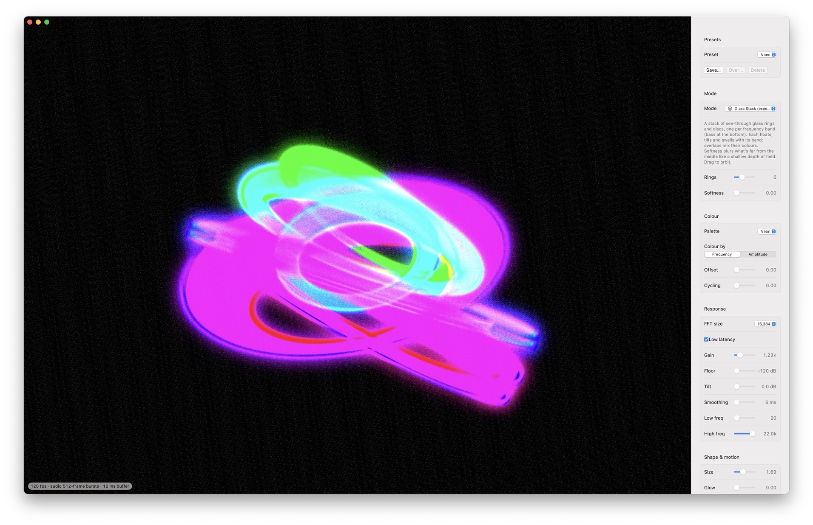

# soundwatch

A music visualizer for macOS. It listens to whatever your Mac is playing, on any output, and draws it.
No virtual audio driver needed, and the sound itself is never touched. Needs macOS 14.2 or later.

[](https://www.instagram.com/itisfinji/)
[](https://soundcloud.com/finji-1)
[](https://buymeacoffee.com/mcut3000)



<p align="center">
  <a href="https://github.com/itymarcel/audio-vis-mac/releases/latest">
    
  </a>
</p>

## Download

Get `soundwatch-<version>.zip` from the [latest release](https://github.com/itymarcel/audio-vis-mac/releases/latest),
unzip it and drag **soundwatch** into your Applications folder. Runs on Apple Silicon and Intel Macs.

## First launch

soundwatch is indie and not notarized by Apple yet, so macOS blocks a downloaded copy the first time:

1. Open the app and click **Done**
2. Go to **System Settings → Privacy & Security** and scroll down
3. Click **Open Anyway**

Then allow **System Audio Recording** when asked (or later under Privacy & Security → Screen & System Audio Recording).
A copy you built yourself skips steps 1–3.

## Build

```bash
./build.sh                   # → build/soundwatch.app
open build/soundwatch.app
./release.sh                 # → build/soundwatch-<version>.zip (Apple Silicon + Intel, for GitHub releases)
```

`build.sh` signs the app ad-hoc at the end. If you put a bundle together some other way, sign it yourself:

```bash
codesign --force --deep --sign - soundwatch.app
```

After a rebuild macOS may ask for the audio permission again.

## Using it

`1`–`8` switch modes, `S` settings, `N` nodes, `Space` freeze, `F` full screen, `T` always on top, `R` re-centre.
Drag to rotate, right-drag or two-finger scroll to pan, scroll or pinch to zoom, ⌘-drag to move the window.
The mode bar at the top and the settings button (top right) fade out when the mouse is idle.
Set the background opacity to 0 for a see-through overlay.

**Modes:** Sphere, Oscilloscope, Snippet, Vectorscope, Halo, Spectrogram, Cymatics (sand on a vibrating plate), Flow (particles in curl noise).
Experimental: Attractor, Harmonograph, Drumhead, Primitives, Field, Mushrooms, Membrane (a rubber sheet that hits push up through), Spectral Fan, Glass Stack and Diamond (a raytraced brilliant with adjustable facets, moving facets and rainbow dispersion).

**Creative controls** at the top of the settings: **Colours** morphs smoothly through all the palettes, **Intensity** calms down or winds up the whole look at once (motion, reach, glow, trails, warp, beat, colour) without moving your other sliders.

**Settings** are per look: palette, response (gain, floor, smoothing, frequency range), shape and motion, feedback warp, post-processing
(colour grade, aberration, pixelate, posterize, soft focus, streak, edge fringe, film grain, scanlines, vignette, flicker) and a media layer
(an image or looping video behind, blended with, masking or warping the visuals, with its own motion). Settings a mode doesn't use are greyed out.
**Presets** save all of it plus the camera view. The app comes with 15 built-in presets; overwrite or delete them as you like.

**Nodes** (`N`) wire the music to any setting: music inputs (bass, mids, highs, bands, loudness, beat, kick/snare/hat hits, pitch),
LFOs and random, modifiers (map, smooth, curve, threshold, math, accumulate…) into any parameter. Right-click the grid to add a node,
drag between dots to connect, ⌫ to delete. The patch is saved with presets.

## Debugging

Environment variables for running the binary (`build/soundwatch.app/Contents/MacOS/soundwatch`) directly. Debug runs never save settings.

| Variable | Does |
|---|---|
| `AUDIOWATCH_WAV=file.wav` | plays a file into the analyser instead of the system audio |
| `AUDIOWATCH_SETTINGS='{"mode":"halo"}'` | overrides saved settings for that run |
| `AUDIOWATCH_SNAPSHOT=/tmp/shot` + `AUDIOWATCH_SNAPSHOT_FRAMES=10,240` | saves those frames as PNGs, then quits |
| `AUDIOWATCH_NODES_SNAPSHOT=/path.png` | saves a picture of the Nodes window |
| `AUDIOWATCH_PERF=1` | prints CPU and GPU time per frame |
| `AUDIOWATCH_TRACE=1` | prints the audio playhead per frame |
