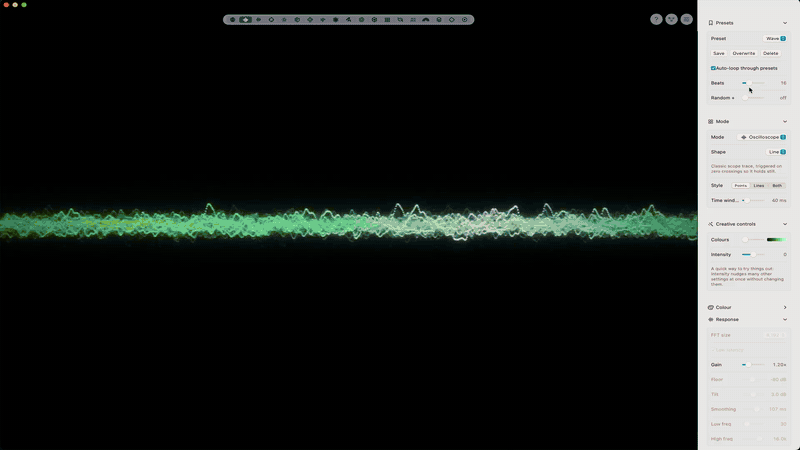

# soundwatch

A music visualizer for macOS. It listens to whatever your Mac is playing, on any output, and draws it.
No virtual audio driver needed, and the sound itself is never touched. Needs macOS 14.2 or later.

[](https://www.instagram.com/itisfinji/)
[](https://soundcloud.com/finji-1)
[](https://buymeacoffee.com/mcut3000)

[](docs/demo.mp4)

<p align="center"><sub><a href="docs/demo.mp4">Watch the full-quality video (with sound)</a></sub></p>

<p align="center">
  <a href="https://github.com/itymarcel/soundwatch/releases/latest">
    
  </a>
</p>

## Download

Get `soundwatch-<version>.zip` from the [latest release](https://github.com/itymarcel/soundwatch/releases/latest),
unzip it and drag **soundwatch** into your Applications folder. Runs on Apple Silicon and Intel Macs.

**Updates:** soundwatch checks GitHub for a new release when it starts (at most once a day) and offers to install it;
**soundwatch → Check for Updates…** checks right away. Installing replaces the app and relaunches it. Your settings and
presets (including ones you deleted) are kept, and new built-in presets are added.

## First launch

soundwatch is indie and not notarized by Apple yet, so macOS blocks a downloaded copy the first time:

1. Open the app and click **Done**
2. Go to **System Settings → Privacy & Security** and scroll down
3. Click **Open Anyway**

Then allow **System Audio Recording** when asked (or later under Privacy & Security → Screen & System Audio Recording).
A copy you built yourself skips steps 1–3.

## Build

```bash
./build.sh                   # → build/soundwatch.app
open build/soundwatch.app
./release.sh                 # → build/soundwatch-<version>.zip (Apple Silicon + Intel, for GitHub releases)
```

`build.sh` signs the app ad-hoc at the end. If you put a bundle together some other way, sign it yourself:

```bash
codesign --force --deep --sign - soundwatch.app
```

After a rebuild macOS may ask for the audio permission again.

## Using it

`1`–`8` switch modes, `S` settings, `N` nodes, `Space` freeze, `F` full screen, `T` overlay mode (only the picture, floating on top; `Esc` exits), `R` re-centre.
Drag to rotate, right-drag or two-finger scroll to pan, scroll or pinch to zoom, ⌘-drag to move the window.
The mode bar at the top and the help, nodes and settings buttons (top right) fade out when the mouse is idle. **?** shows a short intro again (it also appears on first launch).
Set the background opacity to 0 for a see-through overlay. **Anti-aliasing** (Window group, on by default) smooths edges; turn it off for speed on a slow Mac.

**Modes:** Sphere, Oscilloscope, Snippet, Vectorscope, Halo, Spectrogram, Cymatics (sand on a vibrating plate), Flow (particles in curl noise).
Experimental: Attractor, Harmonograph, Drumhead, Primitives, Field, Mushrooms, Membrane (a rubber sheet that hits push up through), Spectral Fan, Glass Stack, Diamond (a raytraced brilliant with adjustable facets, moving facets and rainbow dispersion) and Orbs (chrome metaballs: one orb per frequency band, melted together into one floating mass; loud bands swell their orb out of it) and Image Particles (choose a picture: it becomes up to a million particles on springs; each one's frequency band pushes it out and makes it shimmer, drum hits send shock waves through the picture; **Reacts by** picks which band each particle listens to: Position (left to right), Random, Brightness (dark = bass) or Colour (reds = bass … blues = treble), and the drum waves follow it (kicks shake the bass particles, hats the treble ones); Threshold leaves out the dark pixels, Colours from the image or the palette, Depth for a 3D relief), Splashs (a 3D pool of ferrofluid over an electromagnet driven by the bass: it gathers into a mound and, past the critical field, bristles into the hexagonal spikes of the Rosensweig instability; drum hits splash it; Detail = Fluid, Magnet, Splash) and Real Metaballs (ferrofluid in water inside a glass sphere, simulated as a real liquid on the GPU: tens of thousands of particles with surface tension, viscosity and slight sinking; 3–13 electromagnets around the sphere, each listening to its own slice of the spectrum, magnetise the fluid and pull it towards them, so it stretches into arms, pinches off drops, spikes and splashes; Detail = Fluid, Magnet = the dial, Magnets = how many coils, Hold = how long they keep their strength, Band = which coil hears which part of the spectrum, Centre pull = how strongly it floats back to the middle, Bursts = how easily a sudden hit blows the liquid apart and yanks it towards that magnet, Coil lag (short = snappier). Only the black liquid is drawn). Both use the chrome Reflects / Turn / Blur / Tint for the oily reflections.

**Chrome:** Orbs, and Primitives and Mushrooms with Render set to Chrome, are drawn as polished metal. Pick what it reflects (four HDR photos: Studio, Wood, Moonrise, Night), turn it, and set Blur (sharp mirror to soft satin) and Tint (palette colour).
The HDRIs are from [Poly Haven](https://polyhaven.com) (CC0).

**Beat & tempo:** soundwatch finds the song's tempo and, with **Lock to tempo** (Feedback & beat), fires the beat exactly on time, predicted rather than detected late, and steady through fills and syncopated drums. It needs ~5 s of music to lock and falls back to plain bass hits when there's no steady beat. The FPS overlay shows the BPM; in Nodes, **Beat ramp** rises 0 → 1 over every beat for beat-synced motion.

**Quick controls** at the top of the settings: **Colours** morphs smoothly through all the palettes, **Intensity** calms down or winds up the whole look at once (motion, reach, glow, trails, warp, beat, colour) without moving your other sliders.

**Settings** are per look: palette, response (gain, floor, smoothing, frequency range), shape and motion, feedback warp, post-processing
(colour grade, aberration, pixelate, posterize, soft focus, streak, edge fringe, film grain, scanlines, vignette, flicker) and a media layer
(an image or looping video behind, blended with, masking or warping the visuals, with its own motion). Settings a mode doesn't use are greyed out.
**Presets** save all of it plus the camera view. The app comes with 15 built-in presets (it starts on Acid Garden); overwrite or delete them as you like.
**Auto-loop through presets** (in the Presets group) switches to the next preset on the beat, every N beats plus an optional random number of extra beats.

**Nodes** (`N`) wire the music to any setting: music inputs (bass, mids, highs, bands, loudness, beat, kick/snare/hat hits, pitch),
LFOs and random, modifiers (map, smooth, curve, threshold, math, accumulate…) into any parameter. Right-click the grid to add a node,
drag between dots to connect, ⌫ to delete. The patch is saved with presets.

## Debugging

Environment variables for running the binary (`build/soundwatch.app/Contents/MacOS/soundwatch`) directly. Debug runs never save settings.

| Variable | Does |
|---|---|
| `AUDIOWATCH_WAV=file.wav` | plays a file into the analyser instead of the system audio |
| `AUDIOWATCH_SETTINGS='{"mode":"halo"}'` | overrides saved settings for that run |
| `AUDIOWATCH_SNAPSHOT=/tmp/shot` + `AUDIOWATCH_SNAPSHOT_FRAMES=10,240` | saves those frames as PNGs, then quits |
| `AUDIOWATCH_NODES_SNAPSHOT=/path.png` | saves a picture of the Nodes window |
| `AUDIOWATCH_SIDEBAR_SNAPSHOT=/path.png` | saves a picture of the settings sidebar, then quits (`AUDIOWATCH_SIDEBAR_OPEN=1`: all groups open) |
| `AUDIOWATCH_PERF=1` | prints CPU and GPU time per frame |
| `AUDIOWATCH_TRACE=1` | prints the audio playhead and bass / snare levels per frame (for measuring reaction time) |
| `AUDIOWATCH_RMSCALE=0.5` | pins the render resolution of Glass Stack / Diamond / Orbs (normally adaptive) |
| `AUDIOWATCH_OVERLAY=1` | enters overlay mode after 1 s and leaves it after 2.5 s, printing the window state |
| `AUDIOWATCH_NOGAIN=1` | turns off the fast transient response of Low latency (for comparison) |
