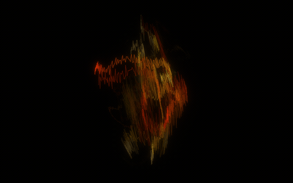
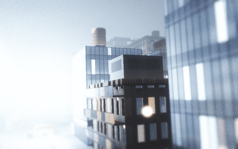
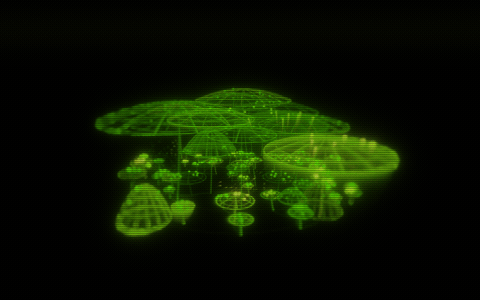
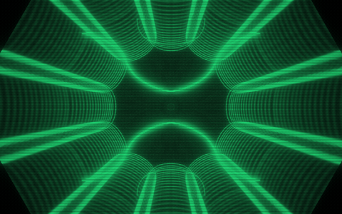

# soundwatch

A music visualizer for macOS. It listens to whatever your Mac is playing, on any output, and draws it.
No virtual audio driver needed, and the sound itself is never touched. Needs macOS 14.2 or later.

[](https://www.instagram.com/itisfinji/)
[](https://soundcloud.com/finji-1)
[](https://buymeacoffee.com/mcut3000)

<p align="center">
  
  
</p>
<p align="center">
  
  
</p>

<p align="center"><sub><a href="docs/demo.mp4">Watch an example video (with sound)</a></sub></p>

<p align="center">
  <a href="https://github.com/itymarcel/soundwatch/releases/latest">
    
  </a>
</p>

## Download

Get `soundwatch-<version>.zip` from the [latest release](https://github.com/itymarcel/soundwatch/releases/latest),
unzip it and drag **soundwatch** into your Applications folder. Runs on Apple Silicon and Intel Macs.

**Updates:** soundwatch checks GitHub for a new release when it starts (at most once a day) and offers to install it;
**soundwatch → Check for Updates…** checks right away. Installing replaces the app and relaunches it. Your settings and
presets (including ones you deleted) are kept, and new built-in presets are added.

## First launch

soundwatch is indie and not notarized by Apple yet, so macOS blocks a downloaded copy the first time:

1. Open the app and click **Done**
2. Go to **System Settings → Privacy & Security** and scroll down
3. Click **Open Anyway**

Then allow **System Audio Recording** when asked (or later under Privacy & Security → Screen & System Audio Recording).
A copy you built yourself skips steps 1–3.

## Build

```bash
./build.sh                   # → build/soundwatch.app
open build/soundwatch.app
./release.sh                 # → build/soundwatch-<version>.zip (Apple Silicon + Intel, for GitHub releases)
```

`build.sh` signs the app ad-hoc at the end. If you put a bundle together some other way, sign it yourself:

```bash
codesign --force --deep --sign - soundwatch.app
```

After a rebuild macOS may ask for the audio permission again.

## Using it

`1`–`8` switch modes, `←` `→` previous / next preset, `S` settings, `N` nodes, `Space` freeze, `F` full screen, `T` overlay mode (only the picture, floating on top; `Esc` exits), `R` re-centre.
Drag to rotate, right-drag or two-finger scroll to pan, scroll or pinch to zoom, ⌘-drag to move the window.
The mode bar at the top and the help, nodes and settings buttons (top right) fade out when the mouse is idle. **?** shows a short intro again (it also appears on first launch).
Set the background opacity to 0 for a see-through overlay. **Anti-aliasing** (Window group, on by default) smooths edges; turn it off for speed on a slow Mac.
**Input** (Response group) chooses what soundwatch listens to: system audio (default) or a microphone / audio interface input (macOS asks for microphone access the first time).
The settings and the nodes can each be **detached** into a window of their own (the window button at their top right; the same button puts them back).
Every slider the nodes can drive has a small **node** icon after its value: click it to add a Parameter node for that setting to the node editor (the editor opens if it's closed). The icon turns orange while a node drives the setting.
While you use the settings or the node editor, heavy scenes render at a third of the resolution so the panels stay responsive; full resolution comes back as soon as you stop.

## Debugging

Environment variables for running the binary (`build/soundwatch.app/Contents/MacOS/soundwatch`) directly. Debug runs never save settings.

| Variable | Does |
|---|---|
| `AUDIOWATCH_WAV=file.wav` | plays a file into the analyser instead of the system audio |
| `AUDIOWATCH_SETTINGS='{"mode":"halo"}'` | overrides saved settings for that run |
| `AUDIOWATCH_SNAPSHOT=/tmp/shot` + `AUDIOWATCH_SNAPSHOT_FRAMES=10,240` | saves those frames as PNGs, then quits |
| `AUDIOWATCH_RECORD=5,2,25` (with `AUDIOWATCH_SNAPSHOT`) | instead: frames `-0000.png`, `-0001.png` … from 5 s on, for 2 s, at 25 fps (for GIFs) |
| `AUDIOWATCH_PRESET="Ember Phase"` | applies that preset and its camera at launch (`AUDIOWATCH_PAN_SCALE=0.3` scales its pan) |
| `AUDIOWATCH_WINDOW=800x500` | window content size in points (not saved) |
| `AUDIOWATCH_NODES_SNAPSHOT=/path.png` | saves a picture of the Nodes panel (rendered off-screen), then quits (`AUDIOWATCH_NODES_EXAMPLES=1`: shows the example patches) |
| `AUDIOWATCH_SIDEBAR_SNAPSHOT=/path.png` | saves a picture of the settings sidebar, then quits (`AUDIOWATCH_SIDEBAR_OPEN=1`: all groups open) |
| `AUDIOWATCH_PERF=1` | prints CPU and GPU time per frame |
| `AUDIOWATCH_PROF=1` | prints the GPU time of each pass of the frame (scene, depth of field, bloom, composite …) every 60 frames; `AUDIOWATCH_CITY_PROFILE=1` / `AUDIOWATCH_FOREST_PROFILE=1` do the same for the City / Forest passes |
| `AUDIOWATCH_FIXED_FPS=60` | runs on a virtual clock (frame n is at n / 60 s, audio from `AUDIOWATCH_WAV` fed to match), so builds of different speed render the same frames |
| `AUDIOWATCH_TRACE=1` | prints the audio playhead and bass / snare levels per frame (for measuring reaction time), and a `DRUM` line per detected kick / snare / hat |
| `AUDIOWATCH_RMSCALE=0.5` | pins the render resolution of Glass Stack / Diamond / Orbs (normally adaptive) |
| `AUDIOWATCH_UIBUSY=1` | acts as if the settings / nodes were being used the whole time (reduced resolution in heavy scenes); `AUDIOWATCH_UIBUSY=4,8` only from 4 s to 8 s after launch |
| `AUDIOWATCH_SLIDE=3` | opens the settings and keeps moving Glow from 3 s on (as a slider drag does), printing how busy the main thread is (`MAINBUSY`) |
| `AUDIOWATCH_OVERLAY=1` | enters overlay mode after 1 s and leaves it after 2.5 s, printing the window state |
| `AUDIOWATCH_NOGAIN=1` | turns off the fast transient response of Low latency (for comparison) |
| `AUDIOWATCH_GI_DEBUG=1` | Landscape with global illumination: draws only the ambient / GI light on grey (the old flat ambient when GI is off) |
| `AUDIOWATCH_GI_FLY=3` | Landscape: how strongly fireflies light their surroundings with GI (default 3) |
